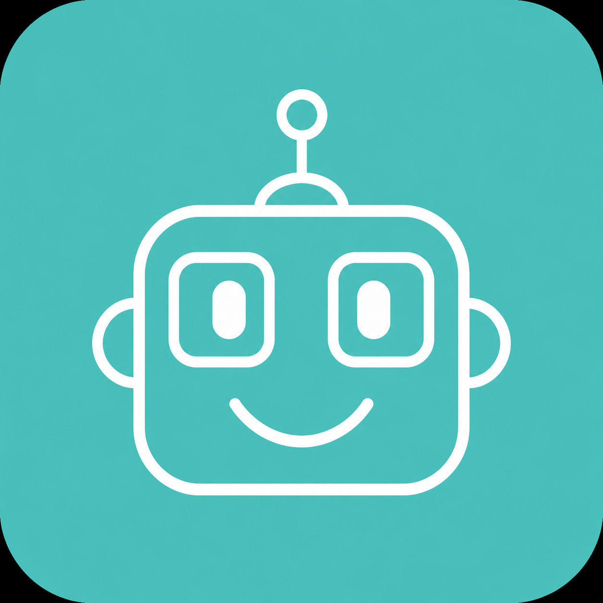

<h1>
  
  LUCA
</h1>

### Lightweight Unified Controller Assistant

*A modular desktop application for robotic manipulator control.*


## Overview

LUCA (Lightweight Unified Controller Assistant) is a desktop application for controlling and monitoring robotic manipulators through a unified graphical interface.

The application combines user interaction, computer vision, motion computation, hardware abstraction, and embedded communication into a modular software architecture. Each subsystem is designed with a clear responsibility, allowing components to be developed, tested, and extended independently.

The current implementation targets a robotic manipulator controlled by an ESP32-based embedded system and is designed to support a pick-and-place workflow using real-time vision and kinematic motion computation.

LUCA is intended as a foundation for future robotics development, with an architecture that supports the addition of new hardware interfaces, motion capabilities, and perception modules without significant changes to the overall system design.

## Features

The current implementation provides:

- A PyQt6-based desktop interface
- Camera integration for workspace monitoring
- OpenCV-based object detection
- Kinematic motion computation
- Mission control and execution
- Hardware abstraction for robot operations
- Serial communication with an ESP32 controller
- Event logging
- Centralized system configuration

## Project Structure

```text
LUCA/
│
├── main.py
├── config.py
│
├── assets/
│   └── icon.png
│
├── ui/
│   ├── components/
│   │   ├── camera.py
│   │   ├── event_log.py
│   │   ├── mission.py
│   │   └── overview.py
│   │
│   ├── widgets/
│   │   └── cards.py
│   │
│   ├── workers/
│   │   └── mission_worker.py
│   │
│   ├── main_window.py
│   ├── styles.py
│   └── theme.py
│
├── core/
│   ├── logger.py
│   ├── models.py
│   └── robot_controller.py
│
├── vision/
│   ├── assets/
│   │   └── background.png
│   │
│   ├── camera.py
│   └── detector.py
│
├── motion/
│   ├── kinematics.py
│   └── trajectory.py
│
├── hardware/
│   ├── arm.py
│   └── gripper.py
│
├── communication/
│   └── serial_interface.py
│
└── firmware/
    ├── command_constants.h
    ├── firmware_config.h
    ├── firmware.ino
    ├── protocol.cpp
    ├── protocol.h
    ├── robot.cpp
    ├── robot.h
    ├── servos.cpp
    └── servos.h
```

## System Architecture
```text
                 User
                  │
                  ▼
          PyQt6 Dashboard
                  │
                  ▼
          Robot Controller
                  │
     ┌────────┬────────┬
     ▼        ▼        ▼
  Vision    Motion   Hardware
   System    System  Abstraction
     │         │         │
     ▼         ▼         ▼
 Camera   Kinematics   Serial Interface
                           │
                           ▼
                         ESP32
                           │
                           ▼
                    Robot Manipulator

```

## Subsystem Overview

### UI
Provides the graphical interface for interacting with the application, displaying camera output, mission status, and system information.

### Core
Coordinates communication between the different subsystems and manages the overall application workflow.

### Vision
Captures images from the camera and performs object detection.

### Motion
Performs kinematic computations required for robot movement.

### Hardware
Provides high-level interfaces for robot motion and gripper control.

### Communication
Handles data exchange between the desktop application and the ESP32 controller.

### Firmware
Runs on the ESP32 and executes low-level hardware control.

## Technology Stack

| Component | Technology |
|-----------|------------|
| Programming Language | Python |
| Desktop Interface | PyQt6 |
| Computer Vision | OpenCV |
| Numerical Computing | NumPy |
| Embedded Controller | ESP32 |
| Firmware | Arduino C++ |
| Communication | Serial |

## Roadmap

Future development may include:

- Background camera processing
- Vision debugging tools
- Improved mission management
- Enhanced trajectory planning
- Collision avoidance
- Object tracking
- Multi-camera support
- Additional communication interfaces

## License

This project is licensed under the MIT License.
